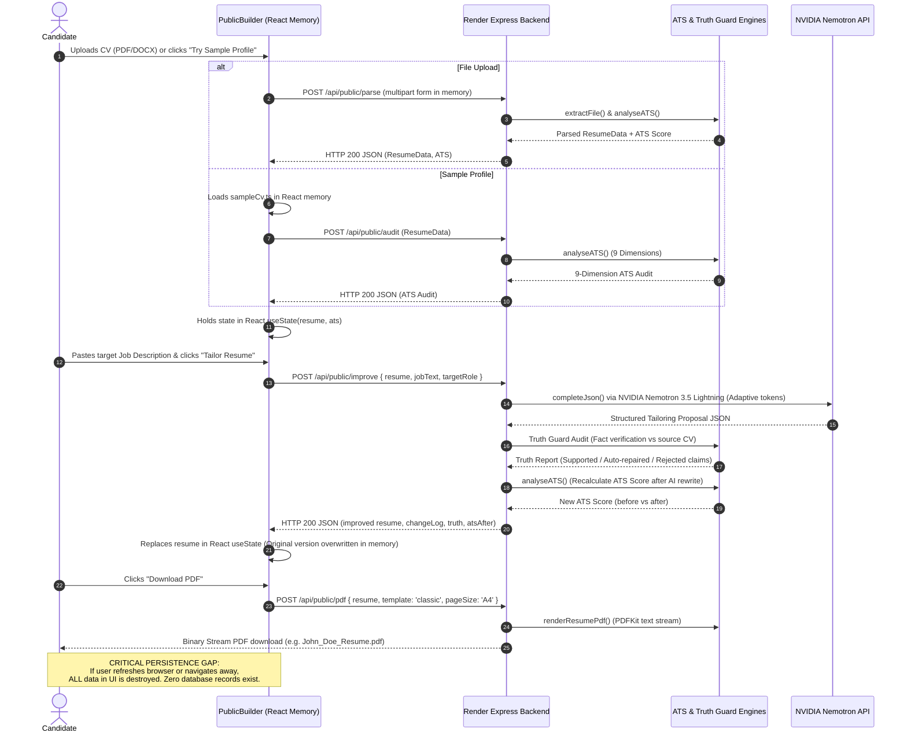
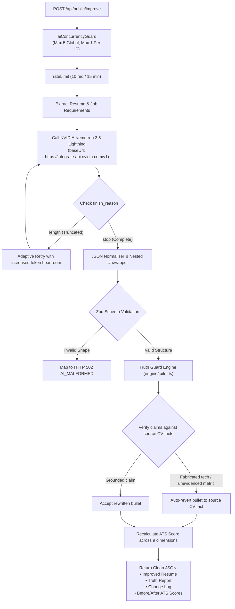

# Curevo AI / EnhanceCV — Phase 9A
# Architecture Diagrams & Data Flow Models

This document presents clear, evidence-based architectural diagrams of EnhanceCV / Curevo AI in its current state versus the proposed target Career OS architecture.

> **Legend**:
> - **Solid arrows (`──>`)**: Verified, active, running production connections.
> - **Dashed arrows (`-.->`)**: Proposed, disconnected, or unverified connections.

---

## 1. Current Frontend Architecture

```mermaid
graph TD
    User["End User (Web Browser)"] ──> Vercel["Vercel Production CDN<br>(https://enhancecv-orpin.vercel.app)"]
    Vercel ──> Router["React Router DOM v7<br>(App.tsx)"]

    subgraph Active_Mounted_Routes ["Active Mounted Routes (Working)"]
        Router ── "/" ──> LandingPage["Landing.tsx<br>(Marketing & Feature Highlights)"]
        Router ── "/builder" ──> PublicBuilder["PublicBuilder.tsx<br>(100% In-Memory State Machine)"]
        Router ── "/ats | /check-ats" ──> RedirectATS["Redirect: /builder?mode=ats"]
        Router ── "/tailor" ──> RedirectTailor["Redirect: /builder?mode=improve"]
        RedirectATS ──> PublicBuilder
        RedirectTailor ──> PublicBuilder
    end

    subgraph Disconnected_Legacy_Routes ["Redirected Legacy Routes (Bypassed)"]
        Router ── "/login | /signup | /app/*" ──> RedirectLegacy["Redirect: /builder"]
        RedirectLegacy ──> PublicBuilder
    end

    subgraph Orphaned_Components ["Orphaned Pages (20 Dead Code Files)"]
        Orphan1["Dashboard.tsx"]
        Orphan2["Applications.tsx"]
        Orphan3["Interview.tsx"]
        Orphan4["MasterCV.tsx"]
        Orphan5["Jobs.tsx"]
        Orphan6["Billing.tsx & 14 others"]
    end

    subgraph Frontend_Memory_Boundary ["Browser State Boundary"]
        PublicBuilder ── "Holds in React useState" ──> ReactMemory["React In-Memory State:<br>• resume (ResumeData)<br>• ats (ATSAnalysis)<br>• truth (TruthReport)<br>• changeLog (ChangeLogEntry[])<br>• coverLetter (CoverLetter)<br>• activeJobText (string)"]
        ReactMemory -. "NO PERSISTENCE (Lost on reload)" .-> NoStorage["localStorage / sessionStorage: NOT USED"]
    end
```

---

## 2. Current Backend Architecture & Service Boundaries

```mermaid
graph TD
    Client["Vercel Frontend / Public Client"] ── "HTTPS Request" ──> RenderAPI["Render Production Container<br>(https://curevo-ai.onrender.com)"]

    subgraph Express_Pipeline ["Express Server Pipeline (app.ts)"]
        RenderAPI ──> HSTS["Helmet & Trust Proxy"]
        HSTS ──> ReqId["X-Request-Id Correlation"]
        ReqId ──> CORS["CORS (Vercel Origin Strict Check)"]
        CORS ──> JsonParser["express.json (1 MB Limit)"]
        JsonParser ──> HealthRoute["GET /api/health (HTTP 200)"]
        JsonParser ──> PublicRouter["Mounted: app.use('/api/public', publicRoutes)"]
        JsonParser ──> NotFound["notFoundHandler (HTTP 404)"]
        NotFound ──> ErrorHandler["errorHandler (Maps Malformed JSON to 400)"]
    end

    subgraph Mounted_Public_Endpoints ["Mounted Public Endpoints (server/src/routes/public.ts)"]
        PublicRouter ──> EP1["GET /api/public/status"]
        PublicRouter ──> EP2["POST /api/public/parse (Multer Memory 8MB)"]
        PublicRouter ──> EP3["POST /api/public/ats (Deterministic Scoring)"]
        PublicRouter ──> EP4["POST /api/public/audit (9-Dimension ATS Audit)"]
        PublicRouter ──> EP5["POST /api/public/match (Job Description Fit)"]
        PublicRouter ──> EP6["POST /api/public/improve (AI Tailoring + Truth Guard)"]
        PublicRouter ──> EP7["POST /api/public/create (AI Generation from Facts)"]
        PublicRouter ──> EP8["POST /api/public/pdf (Stream PDF across 6 templates)"]
        PublicRouter ──> EP9["POST /api/public/cover-letter (ResumeSkills Framework)"]
        PublicRouter ──> EP10["POST /api/public/cover-letter/pdf (Stream Letter PDF)"]
    end

    subgraph Unmounted_Routers ["Unmounted Routers (86 Routes Returning HTTP 404)"]
        NotFound -.-> LegacyAuth["/api/auth (11 routes)"]
        NotFound -.-> LegacyMaster["/api/master (4 routes)"]
        NotFound -.-> LegacyResumes["/api/resumes (9 routes)"]
        NotFound -.-> LegacyJobs["/api/jobs (6 routes)"]
        NotFound -.-> LegacyApps["/api/applications (7 routes)"]
        NotFound -.-> LegacyInterview["/api/interview (7 routes)"]
        NotFound -.-> LegacyOther["/api/billing, /api/dashboard, /api/ai, etc."]
    end
```

---

## 3. Current Data Flow & Ephemeral Lifecycle



---

## 4. Database Connection Reality

```mermaid
graph LR
    subgraph Active_Production_Reality ["Active Production Reality (100% Stateless)"]
        ServerDist["Render Node.js Server Process<br>(server/dist/index.js)"]
        ServerDist ── "Does NOT call getDb()" ──x NoConn["No PostgreSQL Connection Created"]
        ServerDist ── "Does NOT call initializeDatabase()" ──x NoDDL["No DDL Migrations Executed"]
    end

    subgraph Dormant_Database_Code ["Dormant Code in Repository (db.ts)"]
        PoolConfig["pg.Pool Configuration<br>(server/src/db/db.ts)"]
        TableDDL["27 Relational Tables Defined in DDL:<br>• users<br>• resumes<br>• job_descriptions<br>• applications<br>• interview_sessions<br>• subscriptions, etc."]
        PoolConfig -. "Unmounted routers only" .-> TableDDL
    end

    subgraph Remote_Supabase_State ["Remote Supabase Instance"]
        SupabaseDB[("Supabase PostgreSQL DB<br>(Status: Unverified / Inactive)")]
        TableDDL -. "Unverified connection string" .-> SupabaseDB
    end
```

---

## 5. Current AI Request & Reliability Flow



---

## 6. Proposed Target Career OS Architecture (Phase 9B+)

```mermaid
graph TD
    Client["Curevo AI Web App (React / Vite)"]

    subgraph Client_State_Layer ["Client Dual-Mode State Engine"]
        Client ──> StateRouter{"User Auth State"}
        StateRouter -- "Anonymous" --> LocalCache["Browser Storage Engine<br>(localStorage / IndexedDB cache)"]
        StateRouter -- "Authenticated" --> ApiSync["TanStack Query / API Client"]
    end

    subgraph Backend_API_Layer ["Secure Backend API (Express on Render)"]
        ApiSync ── "Session Cookie / Bearer" ──> AuthMiddleware["Auth & Session Validation Middleware"]
        LocalCache ── "Stateless Preview" ──> PublicAPI["/api/public/* (Stateless Tools)"]

        AuthMiddleware ──> AuthRouter["/api/auth (Login, Register, Session)"]
        AuthMiddleware ──> MasterRouter["/api/master (Durable Master CV CRUD)"]
        AuthMiddleware ──> TailorRouter["/api/tailor (Tailored CV Version History)"]
        AuthMiddleware ──> AppRouter["/api/applications (Application Tracker Kanban)"]
        AuthMiddleware ──> InterviewRouter["/api/interview (Interview Prep & Mock)"]
    end

    subgraph Persistence_Layer ["Durable Persistence Layer (Supabase PostgreSQL)"]
        AuthRouter ──> DBUsers[("users & user_sessions")]
        MasterRouter ──> DBResumes[("resumes (kind='master')")]
        TailorRouter ──> DBTailored[("resumes (kind='tailored') & tailoring_runs")]
        AppRouter ──> DBApps[("applications & application_events")]
        InterviewRouter ──> DBInterview[("interview_sessions & interview_questions")]
    end

    subgraph AI_Intelligence_Layer ["Shared AI & Rules Engine"]
        PublicAPI ──> AIProvider["NVIDIA Nemotron 3.5 Lightning"]
        TailorRouter ──> AIProvider
        InterviewRouter ──> AIProvider
        AIProvider ──> TG["Truth Guard Factual Grounding"]
        TG ──> ATS["ATS 9-Dimension Scoring Engine"]
    end
```
