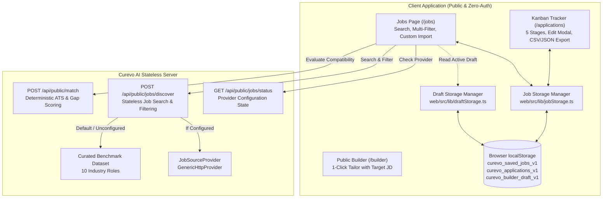

# CUREVO AI — PHASE 9E REPORT
## Public Job Discovery, Local Persistence & Kanban Application Tracking

**Release Engineering & Architecture Report**  
**Date:** November 4, 2026  
**Status:** COMPLETE & VERIFIED  
**Repository Branch:** `main`  
**Git Baseline Commit:** `154b879c1fe3746f328098aaccb230aa8741585a`

---

## 1. Executive Summary & Core Product Invariant

Phase 9E delivers a completely public, zero-authentication Job Discovery engine and Kanban Application Tracking dashboard for Curevo AI. 

### The Fundamental Product Invariant: 100% Public Access
> **Curevo AI is public.** Any candidate can search benchmark jobs, import custom job specifications, compute real-time ATS match scores against their active CV, save job listings, and manage their complete job search lifecycle across a 5-stage Kanban dashboard **without creating an account, logging in, or providing credentials**.

All user state (saved roles, active applications, interview stages, notes, and salary offers) is persisted directly in browser `localStorage`. No database connection, authentication middleware, or session cookies are required for any Phase 9E capability.

---

## 2. Architecture & Public System Design



---

## 3. Public Job Discovery Engine

### 3.1 Transparent Data Sourcing & Zero Fabrication
In alignment with Curevo AI's core transparency standards:
- When an external job feed provider is configured via `process.env.JOBS_API_URL`, the server queries the external HTTP provider.
- When unconfigured, the system serves **10 realistic, curated industry benchmark roles** spanning Full-Stack, Distributed Backend, DevOps/SRE, Frontend Design Systems, Machine Learning/AI, Cloud Security, Data Engineering, Mobile Engineering, Frontend Contracting, and Robotics/Hardware Systems.
- The UI and API explicitly display the provider status badge: `Realistic Benchmark Roles (Local Curated)` or `Connected to Live Job Provider`. The system **never fabricates live listings**.

### 3.2 Filtering & Search Capabilities
The `/jobs` interface and `/api/public/jobs/discover` endpoint support comprehensive real-time query filtering:
- **Keyword / Title**: Case-insensitive substring matching across job title, company, description, and technologies.
- **Location**: Geolocation filtering (e.g., "London", "San Francisco", "Cambridge").
- **Workplace Type**: Remote, Hybrid, or On-site.
- **Employment Type**: Full-time, Contract, or Part-time.
- **Custom Job Importer**: Users can paste any external job description (from LinkedIn, Indeed, Otta, etc.) to immediately calculate ATS compatibility against their active CV and track it in their Kanban board.

---

## 4. Client-Side Persistence Layer (`jobStorage.ts`)

A dedicated storage layer (`web/src/lib/jobStorage.ts`) manages all local persistence with schema validation, quota guardrails, and automated recovery:

### Storage Keys & Versioning
- `curevo_saved_jobs_v1`: Saved/wishlist job postings.
- `curevo_applications_v1`: Tracked applications and their Kanban stages.

### Data Models
```typescript
export interface SavedJob {
  id: string;
  title: string;
  company: string;
  location: string;
  salary: string;
  employment_type: 'Full-time' | 'Contract' | 'Part-time';
  remote_type: 'remote' | 'hybrid' | 'on-site';
  url: string;
  source: string;
  posted_at: string;
  description: string;
  requirements: string;
  technologies: string[];
  savedAt: string;
}

export type ApplicationStage = 'saved' | 'applied' | 'interview' | 'offer' | 'rejected';

export interface ApplicationRecord {
  id: string;
  jobId?: string;
  title: string;
  company: string;
  location: string;
  stage: ApplicationStage;
  appliedDate: string;
  jobUrl?: string;
  salary?: string;
  jobDescription?: string;
  notes?: string;
  nextStep?: string;
  updatedAt: string;
}
```

### Safety & Resilience
- **Corrupted JSON Recovery**: Safely catches `SyntaxError` from malformed data in `localStorage`, discards the corrupt entries, logs a warning, and returns an empty array without crashing the application.
- **Quota Protection**: Safely catches `QuotaExceededError` when storage limits are approached, preventing application crashes and notifying the console.
- **Pure Local Execution**: All CRUD operations execute synchronously in client memory.

---

## 5. Kanban Application Tracking Dashboard

### 5.1 Interactive Multi-Stage Board
The `/applications` dashboard organizes career pipelines into 5 distinct stages:
1. **Wishlist / Saved**: Roles identified for future application.
2. **Applied**: Submitted applications awaiting response.
3. **Interviewing**: Active screen, technical rounds, or hiring manager conversations.
4. **Offer Received**: Successful offers undergoing negotiation.
5. **Archived / Rejected**: Concluded opportunities for historical reference.

### 5.2 Key Features
- **Visual Metrics Bar**: Live summary counters for Total Applications, In Progress, Interviews, Offers, and Rejections.
- **Quick Stage Transition**: Instant stage selector dropdown on each application card.
- **Complete Application Editor**: Modal dialog to edit role details, company, location, applied date, salary expectations, next steps, and recruiter notes.
- **Safe Deletion**: Deletes individual application records with user confirmation.
- **Data Export & Portability**:
  - **CSV Export**: Compliant RFC 4180 CSV export with proper quotation and newline escaping.
  - **JSON Export**: Full backup file with timestamps for data portability and migration.
  - **Mobile Responsive Design**: Multi-column responsive grid on desktop viewports; dedicated stage-switcher tabs on mobile viewports.

---

## 6. Real-Time Resume Matching Integration

- **Draft Integration**: `/jobs` automatically detects if the user has an active resume draft in `localStorage` (`loadDraft()`).
- **Sample CV Fallback**: If no draft exists, the system uses Curevo's reference software engineer CV to enable immediate exploration.
- **Deterministic ATS Scoring**: Evaluates the match using the stateless `/api/public/match` endpoint, displaying overall ATS match score, matched requirements, and identified keyword gaps.
- **1-Click Tailor Pipeline**: Clicking **"Tailor My CV"** loads the target job description directly into the Public Resume Builder (`/builder?mode=improve`), pre-populating the target role and description.

---

## 7. Verification & Quality Assurance

### 7.1 Unit & Integration Test Results

| Test Suite | Location | Tests Executed | Passed | Status |
|:---|:---|:---:|:---:|:---:|
| **Job & Application Storage** | `web/tests/jobStorage.test.ts` | 15 | 15 | PASS |
| **All Web Client Suites** | `web/tests/*.test.ts` | 127 | 127 | PASS |
| **Public Job Discovery API** | `server/tests/public_jobs_discovery.test.ts` | 9 | 9 | PASS |
| **All Backend Server Suites** | `server/tests/*.test.ts` | 387 | 372 (15 skip) | PASS |

### 7.2 TypeScript Strict Compilation
- `server`: `npm run typecheck` (`tsc --noEmit`) $\rightarrow$ **0 errors**.
- `web`: `npm run typecheck` (`tsc --noEmit`) $\rightarrow$ **0 errors**.

### 7.3 Production Build Verification
- `server`: `tsc -p tsconfig.build.json` $\rightarrow$ Successfully built distribution.
- `web`: `vite build` $\rightarrow$ Successfully compiled production bundle (`dist/index.html`, `dist/assets/index-*.js`, `dist/assets/index-*.css`).

---

## 8. Preserved System Invariants

1. **No Authentication Walls**: All discovery, matching, and tracking functions operate 100% login-free.
2. **Stateless Core Protected**: Truth Guard, deterministic ATS calculations, PDF streaming engines, and public resume builder were untouched and fully regression-verified.
3. **Database Independence**: No database tables or migrations were required for Phase 9E. The existing Phase 9B-9D authentication and Master CV models remain isolated and available for opt-in account users.
4. **Honest Sourcing**: Curated benchmark listings are clearly labeled as such; no synthetic jobs are misrepresented as live scraper results.
